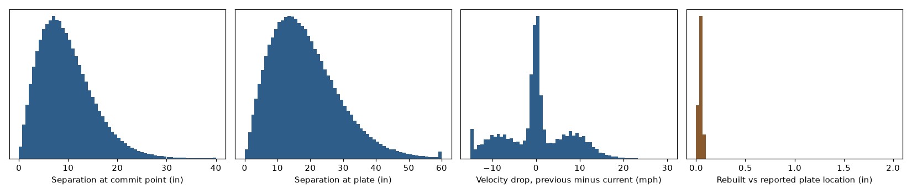
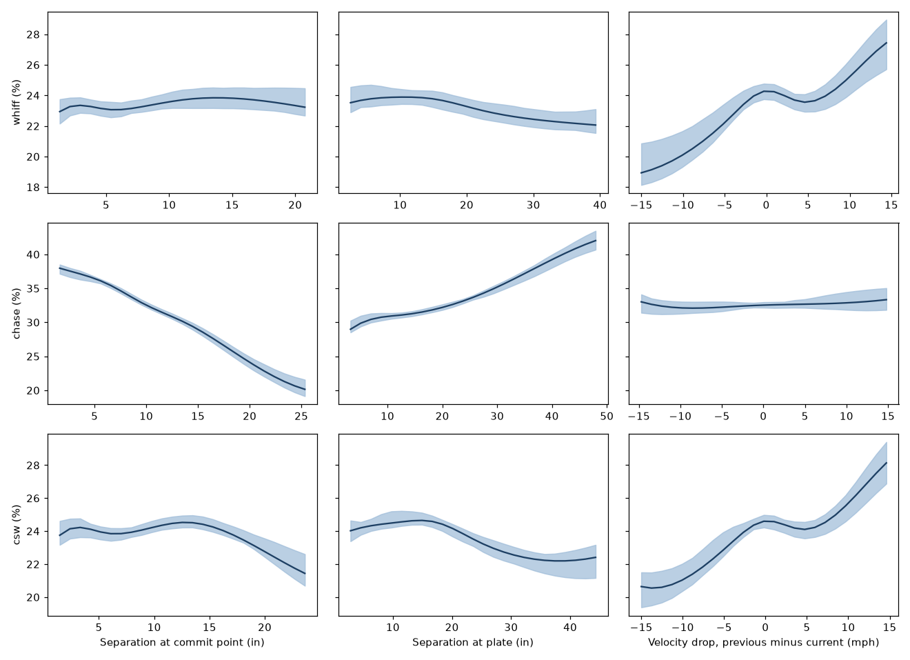

# Pitch Tunneling Analyzer

Pitchers talk about "tunneling": two pitches that look the same until late and then finish in different
places. This repository measures it from pitch trajectories and asks whether it is related to whiffs,
chases and strikes, with the things that confound a raw comparison held fixed.

It uses every regular-season pitch from 2023 (532,822 consecutive-pitch pairs) and 2024 (526,242).

## What it measures

For a pitch and the pitch the same pitcher threw just before it, in the same plate appearance:

- **Commit separation:** how far apart the two pitches are, in inches, 23.8 feet from the plate.
  Median 8.8 inches (10th to 90th percentile: 3.4 to 17.1).
- **Plate separation:** how far apart they finish. Median 16.9 inches (6.5 to 32.4).
- **Velocity drop:** previous speed minus current speed (10th to 90th percentile: -10 to +10 mph).

Positions at 23.8 feet come from rebuilding each pitch's path from Statcast's release point, velocity and
acceleration. The rebuilt location at the plate matches Statcast's reported location to a median of
0.05 inches, which is a check on the plate end of the rebuild, not direct proof that the
intermediate (commit-point) position is correct. See [docs/definitions.md](docs/definitions.md).



## What it found

The idea that tight commit-point tunnels produce more whiffs and strikes is **not supported** by
this data once pitch type, location, count, the previous pitch and the pitcher are held fixed.

**Model.** For each outcome (whiff, chase, CSW) I fit a penalised-spline logistic regression
(`SplineLogit` in [`effects.py`](src/tunneling/effects.py)): a GAM-style model with cubic B-spline smooths
on each tunnel feature, plate location, distance to the zone edge, release speed and the current pitch's
commit-point position, plus current and previous pitch type, count, handedness and the previous
pitch's result. Pitcher enters
as a **ridge-shrunk random-intercept-style effect**: one column per pitcher, with a Gaussian prior
(standard deviation 0.3 on the logit scale), not an unpenalised fixed effect. The prior scale is
set, not estimated, and the spline smoothness comes from one fixed L2 penalty rather than REML as in `mgcv`.
It is not a fitted mixed model, and there are no pitcher random slopes
([why](docs/design_decisions.md)). Intervals come from a pitcher-cluster bootstrap.

Each number is the change in a rate when a feature goes from its 10th to its 90th percentile for every
pitch, everything else as observed (2023, with 95% intervals that resample pitchers). The right-hand
column repeats the model using the pitch **two** back instead of the previous one, on the same rows.
If an effect belongs to adjacent-pitch tunneling, the middle column should be larger than the right.

| Outcome | Feature | Previous pitch | Two pitches back |
|---|---|---|---|
| Whiff per swing | commit separation | +0.1 (-0.4, +0.8) | -0.6 (-1.0, +0.1) |
| | plate separation | -1.3 (-2.0, -0.7) | +0.4 (-0.3, +0.8) |
| | velocity drop | +4.7 (+2.8, +5.8) | +5.1 (+3.2, +6.6) |
| Chase per out-of-zone pitch | commit separation | -13.0 (-13.8, -11.1) | -14.1 (-14.9, -12.7) |
| | plate separation | +7.7 (+6.0, +9.1) | +9.2 (+8.1, +10.3) |
| CSW per pitch | commit separation | -0.3 (-0.8, +0.4) | -0.5 (-1.2, -0.1) |
| | plate separation | -2.1 (-3.3, -1.3) | -0.1 (-0.7, +0.7) |
| | velocity drop | +4.5 (+2.5, +6.1) | +4.5 (+3.3, +6.8) |

- **Whiffs and CSW.** Commit-point separation has no meaningful effect (within a point either way). A
  larger velocity drop goes with about 4.5 to 5 more points, but the pitch two back gives the same
  number, so it reflects the current pitch being slower than earlier pitches, not the specific pitch
  just before. The one signal specific to the previous pitch points the wrong way: a larger plate
  separation from the previous pitch goes with 1 to 2 *fewer* points of whiff and CSW.
- **Chases.** The association is large, and its direction matches the tunneling story: commit separation
  is *negative* (-13.0), so pitches that looked **like** the previous one at the commit point are chased
  *more*, and plate separation is positive (+7.7), so pitches that finish farther from the previous pitch
  are also chased more. The same signs hold in 2024 and in the distance check. But the placebo gives the
  same size, so it is not specific to the adjacent pitch. Something about where earlier pitches were is
  related to chasing; this analysis cannot say what, and it does not support reading it as tunneling.
- **Prediction.** Fit on 2023 and scored on 2024, adding commit and plate separation changes held-out log
  loss from 0.44707 to 0.44709 for whiffs (nothing) and 0.49398 to 0.49376 for CSW (nothing), and
  from 0.49052 to 0.48846 for chases (a small gain).
- **Replication.** 2024 gives the same pattern (`reports/replication_2024`): chase -14.5 and +8.7 at
  lag 1 against -14.3 and +9.7 at lag 2.



A raw look misleads. Whiff rate by decile of plate separation (`reports/figures/whiff_by_decile_descriptive.png`)
is descriptive only: it mixes pitch types and locations along the x-axis.

## Why the first version was changed

Version 0.1 had two copies of the code that disagreed (`src/` and `tunneling/`), scored pairs from the release
point and the plate location only (no trajectory, so no commit point), z-scored the previous and current
pitch with different statistics, divided chase by swings instead of out-of-zone pitches, grouped pairs on the
date, and judged the idea by raw quintiles. Details and the counts are in
[docs/data_quality.md](docs/data_quality.md) and the [changelog](CHANGELOG.md). The raw and processed data
files (about 90 MB) are no longer tracked.

## Limits

- The commit point is a convention (23.8 feet), not a measurement of any hitter. Re-fitting at 20, 23.8, 27
  and 30 feet (`reports/commit_distance_sensitivity.csv`) leaves the conclusions unchanged: commit
  separation moves whiff and CSW by less than a point at every distance, and the chase association stays
  large (-13 points at 20 feet to -10.5 at 30).
- Pitch sequencing is not random. Pitchers choose what to throw after what, so even a lag-1 effect would not
  be causal. The lag-2 comparison tests for specificity, not for causation.
- A pair is two pitches thrown by one pitcher; the model has no hitter effects beyond the matchup.
- Nothing here says tunneling does not matter. It says that the trajectory separation measured this way has
  no specific, adjacent-pitch relationship with whiffs and strikes in two seasons of data.

## Run it

```bash
python -m venv .venv && source .venv/bin/activate
pip install -e '.[dev]'
pytest                                  # 22 tests; analytic trajectory, planted-bug, recovery
python - <<'PY'
from tunneling import sources, integrity, pairs
clean, report = integrity.clean(sources.load_sample())   # 1,300 real pitches, offline
scored = pairs.score_pairs(pairs.build_pairs(clean))
print(scored[["prev_pitch_type", "pitch_type", "commit_sep_in", "plate_sep_in", "velo_diff_mph"]].head())
PY
```

To reproduce the results above (downloads about 400 daily files):

```bash
tunneling fetch   --start 2023-03-20 --end 2023-10-02 --cache data/cache
tunneling pairs   --cache data/cache --start 2023-03-20 --end 2023-10-02 --out data/processed/pairs_2023.parquet
tunneling eda     --cache data/cache --start 2023-03-20 --end 2023-10-02 --pairs data/processed/pairs_2023.parquet
tunneling effects --pairs data/processed/pairs_2023.parquet --out reports --placebo
tunneling holdout --train data/processed/pairs_2023.parquet --test data/processed/pairs_2024.parquet
```

The effect fits take a while (each is 30 bootstrap refits over pitchers).
`notebooks/tunneling_walkthrough.ipynb` checks the trajectory rebuild and the features on the packaged sample.

## More

[definitions](docs/definitions.md), [requirements](docs/requirements.md), [data quality](docs/data_quality.md),
[design decisions](docs/design_decisions.md).

MIT license. Pitch data from Baseball Savant (Statcast).
